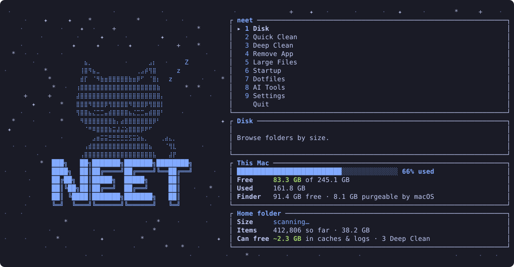

<h1 align="center">neet</h1>

<p align="center">
  <a href="https://github.com/ado11231/neet/actions/workflows/ci.yml"></a>
  <a href="https://crates.io/crates/neet"></a>
  
  
  
</p>

<p align="center">
  
</p>

## Install

* macOS 13 or later, on Apple silicon or Intel.
* Install the published crate with [Rust](https://rustup.rs):

```sh
cargo install neet --locked
```

For the newest code on `master`, including changes not yet released:

```sh
cargo install --git https://github.com/ado11231/neet --locked neet
```

Then start it:

```sh
neet
```

* From a checkout, use `cargo run --release` to build and run that branch.
* Install a checkout with `cargo install --path crates/neet --locked --force`.
* Downloads are also on [GitHub Releases](https://github.com/ado11231/neet/releases).
